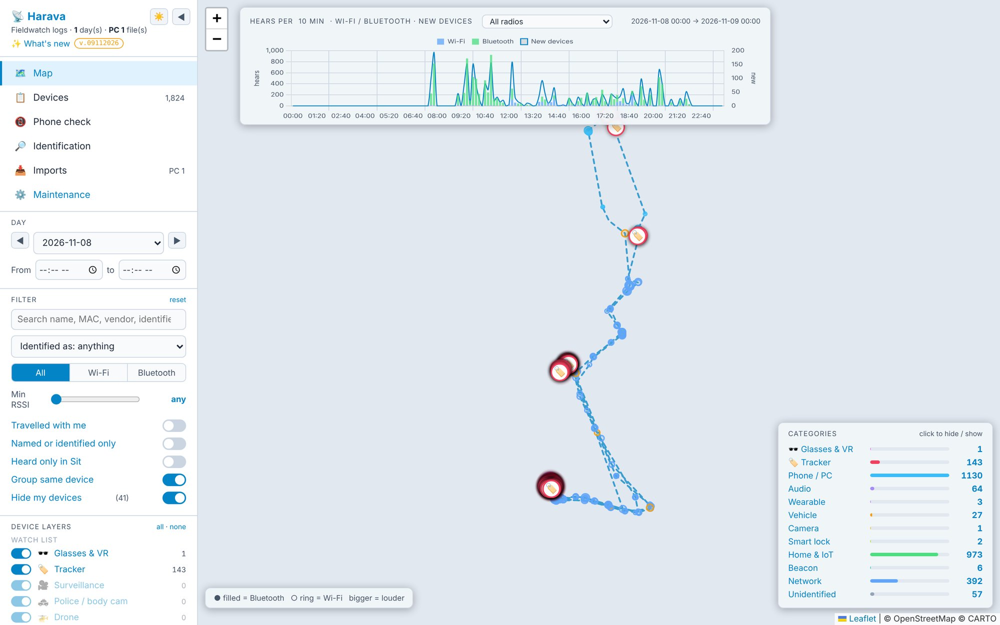

# Harava

*Harava* is Finnish for *rake*: it rakes through what your phone heard.

Harava is a web app for looking through what the [Fieldwatch](https://github.com/OffGridPete/Fieldwatch) Android app heard (Harava is not part of Fieldwatch). It imports Fieldwatch **log** and **Sit** exports (CSV, JSON lines `.jsonl`, KML) into a SQLite database and lets you list, filter and map every Wi-Fi access point and Bluetooth LE radio the phone heard — and names many of the radios Fieldwatch leaves *Unidentified*. Built with Python / Flask and a single-page Leaflet front end; the look follows [oh2gax/wspr_logger](https://github.com/oh2gax/wspr_logger).

It runs on your own computer (open, no sign-in) or on a server behind nginx with HTTPS, users and permissions — the author's runs at `https://harava.oh2gax.org`.



---

## Contents

- [Features](#features)
- [Requirements](#requirements)
- [Running on your own computer](#running-on-your-own-computer)
- [Installation on a server (Ubuntu, nginx, Let's Encrypt)](#installation-on-a-server-ubuntu-nginx-lets-encrypt)
- [Users and permissions](#users-and-permissions)
- [Updating on a server](#updating-on-a-server)
- [Pages](#pages)
- [Identification database](#identification-database)
- [Log and Sit: collect with both](#log-and-sit-collect-with-both)
- [My devices](#my-devices)
- [Phone check (classroom)](#phone-check-classroom)
- [Mask addresses (screenshots)](#mask-addresses-screenshots)
- [Notes on the data](#notes-on-the-data)
- [Configuration](#configuration)
- [What's new, guides and changelog](#whats-new-guides-and-changelog)
- [Project structure](#project-structure)
- [REST API](#rest-api)
- [Privacy](#privacy)
- [License](#license)

---

## Features

- **Import** Fieldwatch log and Sit exports (CSV, JSON lines, KML) by drag and drop or from a folder; files already imported are skipped. Fieldwatch's own KML files, which Google Earth refuses because of hidden Wi-Fi names, load fine.
- **Map** — the phone's path and one pin per radio at the place where it was heard loudest; icon pins for glasses, trackers, surveillance, police, drones and hacking tools; a pulsing ring for a tracker separated from its owner.
- **Timeline** of hears and new radios per 10 minutes, also for one kind of device (e.g. *Glasses & VR only*).
- **Device layers** — one per Fieldwatch signature class, grouped as Watch list, Personal, Places & things and Background.
- **Devices list** with search, filters, sorting and CSV export; tags for radios that **travelled** with you, **separated** trackers, **sit only** radios and Ruuvi temperatures.
- **Harava's own identification database** — the Bluetooth SIG numbers and its own rules name radios Fieldwatch leaves *Unidentified* (97 % of them in the author's data), and join the changing addresses of one device into one row.
- **My devices** — hide your own router, PC, phone and sensors from the analysis.
- **Phone check** — is every phone in the box next to the teacher's phone?
- **Users and permissions** (on a server) — sign-in, *View only*, *Analyze* and *Admin*, a **/maintenance** page for users and a sign-in log.
- **Mask addresses** for screenshots and presentations.
- **What's new, User guides and About** in one window, as in WSPR Logger.

## Requirements

- Python 3.9 or newer and Flask 3 (`requirements.txt`).
- A browser. Leaflet 1.9.4 and Chart.js 4.4.0 come with the app (`static/vendor/`); only the map background tiles (CARTO / OpenStreetMap) are loaded from the internet.
- For a server: Ubuntu (tested on 24.04 LTS), nginx and certbot.
- Optional: a free [CARTO Basemaps](https://carto.com/basemaps/apikey/) API key, so the map has no watermark.

---

## Running on your own computer

1. Install Python 3.9 or newer (on Windows, tick *Add python.exe to PATH*).
2. Download or clone the repository.
3. Double-click **`start_harava.bat`** (Windows). The first run installs Flask. Or from a terminal:
   ```bash
   python -m pip install -r requirements.txt
   python harava.py
   ```
4. The browser opens at <http://127.0.0.1:5057>. Close the window (or press Ctrl+C) to stop.
5. Copy your Fieldwatch exports into `data/` and press **Imports → Scan folder**, or drop them on the Imports page.

On your own computer Harava is **open**: as long as no user has been added, there is no sign-in. (Adding a user — see [Users and permissions](#users-and-permissions) — turns the sign-in on here too.)

### Map key (no watermark)

The map tiles come from [CARTO Basemaps](https://carto.com/basemaps/apikey/). Without a free API key they show an "API key required" watermark. The key works the same way as in WSPR Logger:

```bash
cp api_keys.py.example api_keys.py      # or reuse the api_keys.py of WSPR Logger
```

and put the key in it: `CARTO_API_KEY = "your-carto-key"`. `api_keys.py` is in `.gitignore` and is never committed. Without it Harava still starts; it prints a warning and the map shows the watermark.

---

## Installation on a server (Ubuntu, nginx, Let's Encrypt)

These steps put Harava at `https://harava.oh2gax.org` on an Ubuntu 24.04 server that **already runs other sites** behind nginx (WSPR Logger and others). They only **add** things — a folder, one service and one nginx site with its own certificate — and every nginx change is tested with `nginx -t` before nginx is *reloaded* (not restarted), so the other sites keep running. Replace the domain, the user `ubuntu` and the folder if yours differ.

**What is added:** `~/harava` (the program, its database and settings), `/etc/systemd/system/harava.service`, `/etc/nginx/sites-available/harava.oh2gax.org` (and its link in `sites-enabled`), and a Let's Encrypt certificate for `harava.oh2gax.org`. Nothing else is changed. Harava listens only on `127.0.0.1:5057`; no new port is opened in the firewall or the AWS security group.

### 1 — Check first (changes nothing)

```bash
dig +short harava.oh2gax.org                    # must print the server's public IP (13.60.119.254)
curl -s https://checkip.amazonaws.com           # the same IP
sudo ss -ltnp | grep ':5057 ' || echo "port 5057 is free"
sudo nginx -t                                    # the current nginx setup must be OK before you start
ls /etc/nginx/sites-enabled/                     # your existing sites
grep -rl "harava" /etc/nginx/ || echo "no harava site yet"
python3 --version                                # 3.9 or newer (24.04 has 3.12)
```

If port 5057 is taken, choose another port and use it in `config.ini` (step 4) and in the nginx file (step 8).

### 2 — Packages

```bash
sudo apt update
sudo apt install -y git python3-venv
certbot --version || sudo apt install -y certbot python3-certbot-nginx
```

nginx and certbot are normally there already (WSPR Logger uses them); nothing is upgraded or reconfigured by this.

### 3 — Get the code and a virtual environment

```bash
cd ~
git clone https://github.com/oh2gax/harava.git
cd harava
python3 -m venv venv
venv/bin/pip install -r requirements.txt
```

### 4 — Settings (`config.ini`)

`config.ini` is a local file that is never in git, so updates never touch it:

```bash
cat > config.ini <<'EOF'
[app]
host = 127.0.0.1
port = 5057
database = harava.db
watch_folder = data
open_browser = false
travel_min_m = 500
require_login = true
behind_proxy = true
session_days = 30
EOF
```

- `host = 127.0.0.1` — only nginx on the same machine can reach Harava.
- `require_login = true` — Harava refuses to start until an admin exists (step 6), so it is never on the internet without a sign-in.
- `behind_proxy = true` — Harava trusts nginx's `X-Forwarded-*` headers (real client address in the sign-in log, HTTPS-only cookies).

### 5 — Map key

```bash
cp ~/wspr_logger/api_keys.py ~/harava/api_keys.py     # adjust the WSPR Logger folder if needed
chmod 600 ~/harava/api_keys.py
```

(Or `cp api_keys.py.example api_keys.py` and type the key.)

### 6 — The first admin

```bash
venv/bin/python harava.py --add-admin
```

It asks for a username, first and last name and a password (at least 12 characters, twice). The users are stored as password hashes in `harava_users.db`, which is not in git. All other users are added later on the **/maintenance** page.

### 7 — The service

```bash
sudo cp deploy/harava.service /etc/systemd/system/harava.service
# if your user is not "ubuntu" or the folder is not /home/ubuntu/harava:  sudo nano /etc/systemd/system/harava.service
sudo systemctl daemon-reload
sudo systemctl enable --now harava
systemctl status harava --no-pager
curl -s http://127.0.0.1:5057/healthz            # ok
curl -sI http://127.0.0.1:5057/ | head -3        # 302 to /login
```

The log: `journalctl -u harava -f`. If the service does not start, `journalctl -u harava -n 50` tells why (for example *require_login = true but there are no users yet*: go back to step 6).

### 8 — nginx (this site only)

```bash
sudo cp deploy/harava.oh2gax.org.nginx /etc/nginx/sites-available/harava.oh2gax.org
sudo ln -s /etc/nginx/sites-available/harava.oh2gax.org /etc/nginx/sites-enabled/harava.oh2gax.org
sudo nginx -t && sudo systemctl reload nginx
curl -sI http://harava.oh2gax.org/ | head -3     # 302 to /login
```

If `nginx -t` reports an error, nothing has been reloaded and the other sites are untouched; remove the link (`sudo rm /etc/nginx/sites-enabled/harava.oh2gax.org`), fix the file and try again. The file handles only `server_name harava.oh2gax.org`, allows uploads up to 512 MB and passes everything to `127.0.0.1:5057`.

### 9 — HTTPS with Let's Encrypt

```bash
sudo certbot --nginx -d harava.oh2gax.org
sudo nginx -t
curl -s https://harava.oh2gax.org/healthz        # ok
sudo certbot renew --dry-run                     # renewal works (the existing certbot timer renews it)
```

Certbot asks for the certificate of this one name and edits only the Harava site file (it adds the `listen 443 ssl` lines and the redirect from http to https). When it asks, choose the redirect.

### 10 — Check the other sites and sign in

```bash
systemctl status nginx --no-pager | head -5
curl -sI https://<your WSPR Logger address>/ | head -1    # still HTTP 200
```

Open `https://harava.oh2gax.org`, sign in with the admin of step 6, add users on **⚙️ Maintenance**, and upload Fieldwatch exports on **Imports**.

### Backups and removing

- The data that matters on the server: `harava.db` (imports, My devices), `harava_users.db` (users), `config.ini`, `api_keys.py` and `.harava_secret` (the key that signs the sign-in cookies). `update.sh` copies both databases to `~/harava_backups/` before every update; copy them off the server now and then (`scp`).
- To remove Harava completely: `sudo systemctl disable --now harava`, `sudo rm /etc/systemd/system/harava.service /etc/nginx/sites-enabled/harava.oh2gax.org /etc/nginx/sites-available/harava.oh2gax.org`, `sudo nginx -t && sudo systemctl reload nginx`, `sudo certbot delete --cert-name harava.oh2gax.org`, and delete `~/harava`.

### Troubleshooting

| Symptom | Cause and fix |
|---------|---------------|
| *502 Bad Gateway* | The service is not running: `systemctl status harava`, `journalctl -u harava -n 50`. |
| *413 Request Entity Too Large* on upload | The file is over 512 MB: raise `client_max_body_size` in the site file (and `MAX_CONTENT_LENGTH` in `harava.py`). |
| *Too many failed sign-ins* | Five wrong passwords from one address lock it for 15 minutes (30 from all addresses lock everyone). Wait, or `sudo systemctl restart harava`. |
| Forgotten admin password | `cd ~/harava && venv/bin/python harava.py --add-admin` with the same username sets a new password. |
| The sign-in log shows `127.0.0.1` for everyone | `behind_proxy = true` is missing from `config.ini`. |

---

## Users and permissions

Without any users Harava is open (your own computer). With at least one user every page needs a sign-in, and each user has one permission:

| Permission | Can |
|------------|-----|
| **View only** | see the map, the Devices list, the Phone check and the Identification page; export CSV; read the guides |
| **Analyze** | the above, and change data: upload and import Fieldwatch exports, scan the folder, switch or delete imports, edit My devices, reload the identification database |
| **Admin** | the above, and manage users on **/maintenance** |

- **The first admin** comes from the command line: `python harava.py --add-admin` (on the server: `venv/bin/python harava.py --add-admin`). The same command with an existing username sets a new password and makes that user an admin — the way back in after a forgotten password.
- **/maintenance** (⚙️ *Maintenance* in the menu, admins only): every user with username, first and last name, permission, *active* switch and last sign-in; **＋ Add user**; **New password**; **Remove**; and the log of sign-ins, failed sign-ins and changes. A new user and a reset password get a **one-time password** that is shown once; at the first sign-in the user must choose their own (at least 12 characters).
- **My account** (👤 your name in the menu): change your own password. Changing it signs out your other sessions.
- Harava keeps at least one active admin: the last admin cannot be removed, disabled or demoted, and nobody can remove or disable themselves.
- A permission change, a disabled user and a new password take effect at once, also for a user who is signed in.
- **Security:** passwords are stored as salted hashes (Werkzeug scrypt); sessions are signed cookies (`HttpOnly`, `SameSite=Lax`, HTTPS-only behind nginx) that last *session_days* with *Keep me signed in*; failed sign-ins are slowed down and locked out (5 per address / 30 in all per 15 minutes); requests that change data must come from Harava's own page; pages are sent with `no-store`, `X-Frame-Options: DENY` and `nosniff`. Users live in `harava_users.db`, apart from the radio data, so clearing `harava.db` never removes a sign-in.

## Updating on a server

`update.sh` (in the repository root) brings the server's copy up to date with GitHub, restarts the service and checks that Harava answers again — the same script as in WSPR Logger:

```bash
bash ~/harava/update.sh
```

It shows the new commits and changed files and asks `Update to <hash>? [y/N]`. After `y` it:

1. copies `harava.db` and `harava_users.db` to `~/harava_backups/pre_update_<time>/` (SQLite online backup, safe while the service runs; the 7 newest are kept);
2. checks every changed `.py`, template and `.json` file straight from git **before touching anything** — if one fails, nothing is changed and the old version keeps running;
3. fast-forwards the checkout (`git merge --ff-only`);
4. runs `pip install -r requirements.txt` only if that file changed;
5. restarts **only** the `harava` service and waits (up to 40 s) until `/healthz` answers.

| Option | Description |
|--------|-------------|
| `-y`, `--yes` | Do not ask |
| `--rollback` | Return to the version that ran before the last update and restart (your `config.ini` is kept) |
| `-h`, `--help` | Show the usage |

**Local files are never overwritten.** `config.ini`, `api_keys.py`, `harava.db`, `harava_users.db`, `.harava_secret` and `data/` are not in git, and the script never runs `git reset`, `git stash` or `git checkout`. If GitHub changes a file that is also modified on the server, it stops without changing anything and explains what to do. It also warns when `api_keys.py` is missing, when `require_login` is not true, or when there are no users.

**Requirements:** a `git clone` with `venv/` next to `harava.py`, and `sudo systemctl restart` allowed for the user. Other service name: `SERVICE=myname bash update.sh`. Run it as `bash update.sh` and do not `chmod +x` it (git would see the changed mode as a local edit).

---

## Pages

| Page | What it does |
|------|--------------|
| **Map** | The phone's path and one pin per radio, at the place it was heard loudest. Filled pins are Bluetooth and rings are Wi-Fi; bigger means louder, and the colour shows the layer. Click a pin for the radio's details, its RSSI over time and every place it was heard. The timeline at the top shows hears and new radios per 10 min; click a bar to zoom in. Its **Show** selector limits the graph to one kind of device. |
| **Devices** | Sortable table of all radios with filters and CSV export. Tags mark *travelled*, *separated* trackers, *sit only*, *N addr.* (one device, many addresses) and Ruuvi temperatures. **＋** marks a radio as one of *My devices*. |
| **Phone check** | The classroom phone-box check (below). |
| **🔎 Identification** | How much Harava's own database identifies, which rules matched, and the most common advertisements that are still unknown. |
| **Imports** | Drop files, or press **Scan folder** to read every new `.csv` / `.jsonl` / `.kml` in `data/` (sub-folders included). Each file can be switched off or deleted. |
| **⚙️ Maintenance** | Users, permissions and the sign-in log (admins only; a separate page at `/maintenance`). |

Sidebar filters: day and time window; Wi-Fi or Bluetooth; minimum RSSI; *Identified as* (one kind of identified device, grouped by layer); *Travelled with me* (the same address ≥ 500 m apart, in two or more places); *Named or identified only*; *Heard only in Sit*; *Group same device*; *Hide my devices*.

### Device layers

Every device class in Fieldwatch's signature catalogue is its own map layer, with a switch in the sidebar (the classes come from `signature_classes.json`, taken from the Fieldwatch repository, MIT licence). Click a layer name to show **only** that layer, again to show all; click a group title to show that group. The choice is remembered.

| Group | Layers |
|-------|--------|
| **Watch list** (icon pins) | 🕶️ **Glasses & VR** (Ray-Ban / Meta, Even G1, Snap Spectacles, Vuzix, RayNeo, Brilliant Frame, and VR headsets such as Meta Quest) · 🏷️ **Tracker** (AirTag / Find My, Find Hub, DULT, SmartTag, Tile, Chipolo, Pebblebee) · 🎥 **Surveillance** · 🚓 **Police / body cam** · 🚁 **Drone** · 💀 **Hacking tool** |
| **Personal** | Phone / PC · Audio · Wearable · Health |
| **Places & things** | Vehicle · Camera · Smart lock · Home & IoT · Thermostat · Shelf label / sign · Beacon · Mesh radio |
| **Background** | Network (Wi-Fi access points) · Unidentified |

**Glasses & VR** share one layer, because Meta uses the same Bluetooth ID for its Ray-Ban glasses and its Quest headsets; a name such as *Quest*, *Oculus*, *Pico*, *Vive* or *Vision Pro* adds a **VR?** tag. For trackers Harava reads from the raw data whether the tag is **separated** from its owner or **near owner**; for Ruuvi tags it decodes temperature, humidity, pressure and battery.

## Identification database

Fieldwatch's signatures name only part of what it hears; in the author's log of 8 November 2026 it left 1,782 of 2,377 Bluetooth radios *Unidentified*, and Harava names 1,725 of them (97 %; 99 % of those with advertising data). The database is in `ids/`:

| File | What it holds |
|------|---------------|
| `ids/bt_assigned_numbers.json` | The Bluetooth SIG *Assigned Numbers*: 4,065 company identifiers, 819 service and member UUIDs, 51 advertising data types. Refresh with `python tools/update_bt_numbers.py` (downloads from the SIG's public repository on bitbucket.org). |
| `ids/harava_ids.json` | Harava's own rules, tried in order (the first match wins). A rule can match the radio kind, a name (regular expression), the company number, the start of the manufacturer data, an AD type and the start of its data, service data, 16-bit or 128-bit services. The file starts with a description of every field. |

It recognises among others: Bluetooth Mesh devices (not set up / set up), EV charging points that advertise as Mesh devices named *Charge*, Philips Hue and other Signify lighting, LE Audio, heart-rate sensors, Apple Continuity messages (AirPods, iPhone / iPad / Mac, Handoff, AirPlay, AirDrop, HomeKit …), Samsung Galaxy devices, Windows PCs, Google services, Oral-B toothbrushes, OnePlus, EcoFlow, Ruuvi, TVs, audio devices and wearables.

- **Identified as** and **Company / vendor** are columns on the Devices page and rows in the Selected radio panel; a grey name with **?** is a weak guess. A radio Fieldwatch left *Unidentified* moves to the layer the rule gives.
- **Group same device.** Many devices change their Bluetooth address every few minutes. When the data proves that addresses belong to one device — the same Bluetooth Mesh device UUID, or the same custom service UUID *and* the same name — Harava joins them; with *Group same device* on, a group is one row with an **N addr.** tag. A shared custom UUID alone is not proof (Ruuvi tags, Windows PCs and Galaxy Buds each share one).
- The **🔎 Identification** page lists every rule with its hits and the most common unknown advertisements — the place to look for the next rule. Edit `ids/harava_ids.json` and press **Reload database** (Analyze permission); no restart is needed.

## Log and Sit: collect with both

| | **Log** (Reports → Log export) | **Sit** (Reports → Start sit … End sit, then Sit export) |
|---|---|---|
| What | Hear by hear, with time, signal, raw data, vendor | One row per radio for the whole sit: first / last heard, hits, min / max signal, signatures, *Mine* |
| Gaps | A row the first time a radio is heard, then every 25th hear, **at most 16 rows per scan**: a radio heard briefly in a crowded place can be missed | Keeps **every** radio (up to 6000) |
| Needs | *Write to disk* on | Nothing extra |

Collect with **both**: keep logging on and run a Sit; export **Log export CSV** and **Sit export CSV** and import both. A radio in both shows up once; radios only the Sit has get a **sit only** tag (*Heard only in Sit* lists them); the timeline, the path and the Phone check come from the log; a newer export of the same sit replaces the older one; radios marked *Mine* in Fieldwatch become My devices.

## My devices

Mark your own radios (router, PCs, phone, Ruuvi tags, car …) so they do not clutter the analysis: press **＋** on a Devices row or **＋ Mark as my device** in the map's detail panel, check the label and press **Add** (Analyze permission). Match by *Address is*, *Address starts with*, *Name is* or *Name contains*; Bluetooth phones, PCs and earbuds change their address, so match them by **name** (＋ chooses that by itself). **Hide my devices** (on by default) hides them from the list, the map and the Phone check. The rules are stored in `harava.db` and apply to every day.

## Phone check (classroom)

At the start of a lesson, everyone's phone goes into a box next to the teacher's phone, which runs Fieldwatch. Phones in the box are heard strongly, a phone left in a pocket in the same room more weakly, phones outside the room weaker still.

1. Let Fieldwatch scan during the lesson; afterwards export the log and import it.
2. Choose the day; in Phone check set the **window start** to a moment when the phones are in the box and a **length** of 2–5 min.
3. Set **Expected phones** (e.g. 30) and press **Auto-calibrate box** — the box limit goes just below the Nth strongest phone, or into a clear gap (≥ 6 dB); defaults box ≥ −55 dBm, room ≥ −80 dBm.
4. The page counts phones **in the box**, **in the room but not in the box** and **weak / outside**, gives a verdict and lists the suspects.

Keep the window short (phones change their address about every 15 minutes), use a cardboard or plastic box (metal blocks the signal), and calibrate once in the real room. The check counts radios and does not identify students; agree its use with the school and follow its rules and data-protection law.

## Mask addresses (screenshots)

**Mask addresses** under *Map layers* changes only what is drawn on the screen: every MAC address keeps only its maker part (`40:86:CB:••:••:••`), every Wi-Fi network name — your own too — becomes *Wi-Fi network 1, 2 …*, and other people's PC names and personal names (*Anna's iPhone*) are hidden. Wi-Fi names together with their addresses can be looked up in public Wi-Fi maps and point to a home, so use it for every screenshot you share. The data, the CSV export and the database are not changed. The screenshots in this repository were taken with it.

## Notes on the data

- Every latitude / longitude is **where your phone was** when it heard the radio, not where the radio is.
- Fieldwatch writes a log row the first time it hears a radio and then on every 25th repeat (at most 16 rows per scan batch); it forgets a radio after 15 min of silence. **Hear counts are not time spent nearby.**
- KML and Sit exports carry no raw advertising data, so a radio that only they have cannot be identified from its data.
- A KML that overlaps an imported log is switched off automatically (it repeats the same radios); you can switch it back on in Imports.
- Fieldwatch 1.1.42 KML exports can contain NUL characters (hidden Wi-Fi names) that Google Earth refuses; Harava removes them while importing.

## Configuration

`config.ini` is a local file (not in git). Copy `config.ini.example` to `config.ini` and change what you need; everything has a default.

| Key (section `[app]`) | Default | Meaning |
|-----|---------|---------|
| `host` | `127.0.0.1` | address to listen on; keep `127.0.0.1` behind nginx |
| `port` | `5057` | port |
| `database` | `harava.db` | SQLite file of the radio data (relative to the program folder) |
| `watch_folder` | `data` | folder that *Scan folder* reads, sub-folders included |
| `open_browser` | `true` | open the browser at start (`false` on a server) |
| `travel_min_m` | `500` | a radio heard this far apart, in two or more places, *travelled with me* |
| `require_login` | `false` | `true`: refuse to start without users (use it on a server) |
| `behind_proxy` | `false` | `true` behind nginx with HTTPS: trust `X-Forwarded-*`, HTTPS-only cookies |
| `session_days` | `30` | how long *Keep me signed in* lasts |

Command line: `python harava.py` (start), `--no-browser` (do not open a browser), `--add-admin` (add an admin or reset a password).

## What's new, guides and changelog

*✨ What's new* under the name at the top left opens one window with three tabs, as in WSPR Logger: **What's new** (`doc/whats_new.md`; each `## v.DDMMYYYY — headline` is one day of development and the newest gives the version in the badge), **User guides** (the PDFs in `doc/`, described in `doc/guides.json`) and **About**. The guides:

- `doc/Harava_User_Guide.pdf` — how to collect with Fieldwatch and read every part of the page.
- `doc/Harava_Admin_Guide.pdf` — server installation, users and permissions, updating and backups.

Both are built from `doc/src/*.tex` with `pdflatex` (three runs); their screenshots (taken with *Mask addresses*) are in `doc/src/guide_img/`. The technical history is in [CHANGELOG.md](CHANGELOG.md).

## Project structure

```
harava.py                 the app: Flask routes, import, analysis, identification, users and sign-in
templates/index.html      the page
templates/login.html      sign-in
templates/account.html    my account (change password)
templates/maintenance.html  users, permissions and the sign-in log (admins)
static/app.js, app.css    front end
static/info.js            the What's new / User guides / About window
static/privacy.js         Mask addresses
static/admin.css          sign-in, account and maintenance pages
static/vendor/            Leaflet 1.9.4 (BSD-2-Clause) and Chart.js 4.4.0 (MIT)
ids/                      identification database: harava_ids.json, bt_assigned_numbers.json
tools/update_bt_numbers.py  downloads the newest Bluetooth SIG lists into ids/
signature_classes.json    Fieldwatch signature name -> class (from the Fieldwatch repository, MIT)
doc/                      guides (PDF), whats_new.md, guides.json, src/ (LaTeX + screenshots)
deploy/harava.service     systemd unit for a server
deploy/harava.oh2gax.org.nginx  nginx site for a server
update.sh                 server update script
start_harava.bat          Windows start script
config.ini.example        settings template        (config.ini: local, not in git)
api_keys.py.example       CARTO key template       (api_keys.py: local, not in git)
CHANGELOG.md              technical history
```

Local only, never in git: `config.ini`, `api_keys.py`, `harava.db` (radio data), `harava_users.db` (users), `.harava_secret` (cookie key), `data/` (your Fieldwatch exports) and `tmp_files/`.

## REST API

All routes need a sign-in once users exist (otherwise `401`), and the routes that change data need the permission shown.

| Method | Route | Permission | What |
|--------|-------|------------|------|
| GET | `/api/summary`, `/api/devices`, `/api/path`, `/api/timeline`, `/api/device`, `/api/imports`, `/api/ids`, `/api/own` | View only | the data behind the pages (`?day=YYYY-MM-DD`, `from`, `to`) |
| GET | `/api/export.csv` | View only | the Devices list as CSV |
| POST | `/api/import` (multipart `files`), `/api/scan` | Analyze | import uploaded files / the watch folder |
| POST, DELETE | `/api/imports/<id>/toggle`, `/api/imports/<id>` | Analyze | switch or delete an import |
| POST, DELETE | `/api/own`, `/api/own/<id>` | Analyze | My devices rules |
| POST | `/api/ids/reload` | Analyze | read the identification files again |
| GET, POST, PUT, DELETE | `/api/users`, `/api/users/<id>`, `/api/users/<id>/password` | Admin | users |
| POST | `/api/account/password` | signed in | change your own password |
| GET | `/healthz` | none | `ok` — for `update.sh` and monitoring |

## Privacy

Harava handles the addresses and names of radios that belong to other people, and the places where your phone was. Keep your Fieldwatch exports and the databases private (`data/`, `harava.db` and `tmp_files/` are in `.gitignore`), use **Mask addresses** for anything you share, and follow the law of your country on collecting and processing such data.

## License

MIT — see [LICENSE](LICENSE). Bundled: Leaflet (BSD-2-Clause), Chart.js (MIT), `signature_classes.json` from Fieldwatch (MIT); `ids/bt_assigned_numbers.json` is derived from the Bluetooth SIG *Assigned Numbers*. Fieldwatch is a separate project by OffGridPete.
